# HealthBridge AI

**One Patient. One Journey. Connected Care Worldwide.**

A patient-controlled care-continuity and international collaboration platform — built as a
**synthetic-data research and engineering demonstration. It is not a clinically validated medical product.**

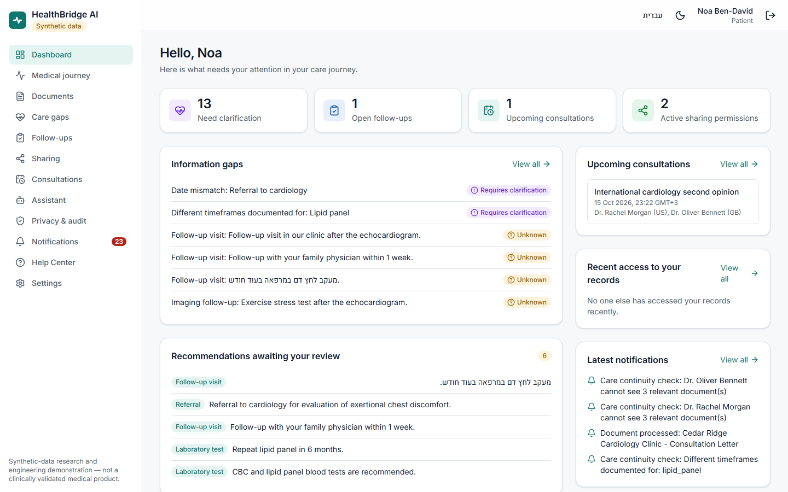

## What

HealthBridge AI makes the patient the coordinator of their own healthcare information. It brings documents from
different organizations into one journey, extracts the recommendations they contain (always linked to the exact
source passage), shows which follow-ups are verified, open, unknown or unclear, lets the patient decide precisely who
may see what and for how long, and supports secure video consultations with several physicians in different countries.

## Why

Care is fragmented: an HMO visit, a private specialist, an emergency department, a laboratory and an overseas
second opinion each hold part of the story. Recommendations get lost between them, and nobody can easily tell
whether a follow-up happened, is pending, or simply isn't documented anywhere. Patients carry the consequences —
and the burden of re-explaining their history.

## How

| | |
|---|---|
| **Patient intelligence** | Upload PDF, text or FHIR R4 → text, date, organization and author detection → recommendations with source passages → automatic journey events → human review and correction |
| **Care gap intelligence** | 9 deterministic, replayable rules. *Unknown* never means *not done*; only documents verify completion; suggestions are administrative questions, never clinical advice |
| **Global collaboration** | Scheduling across time zones, self-hosted LiveKit video (multi-participant, screen share, chat, no recording), notes, versioned summaries that **every** participating physician must approve, patient-approved handoffs |
| **Trust & governance** | Granular, expiring consent with preview and immediate revocation; server-side object-level authorization; tamper-evident audit visible to the patient; admins without clinical access |
| **Bounded assistant** | Tool allowlist, authorization before retrieval, cited answers, refusals for diagnosis/prescribing, confirm-to-act; deterministic by default, optional local LLM (Ollama) with output validation and fallback |

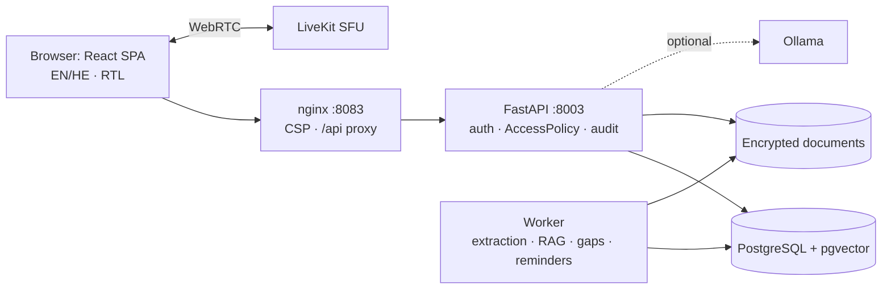

Golden scenario flow and full diagrams: [docs/architecture.md](docs/architecture.md).

## Screens

| | |
|---|---|
| 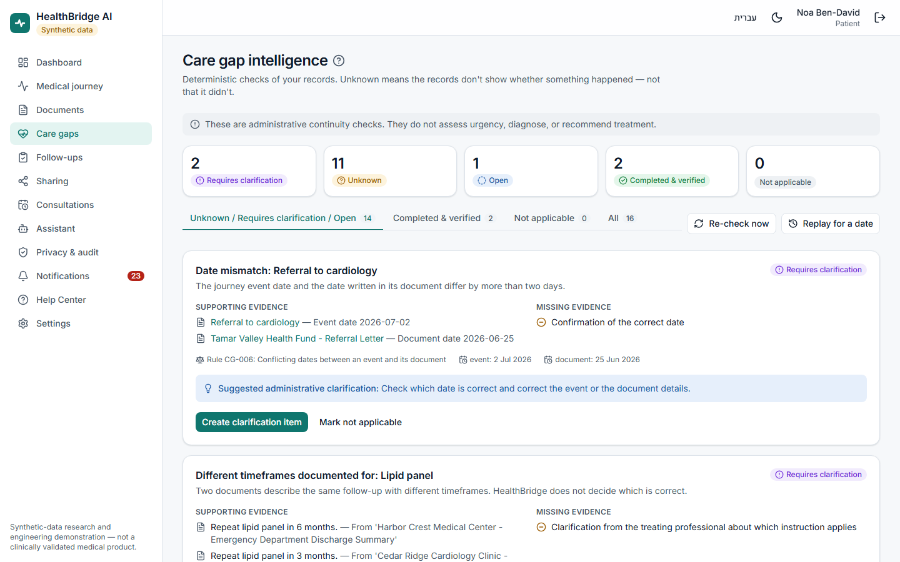 Care gap intelligence | 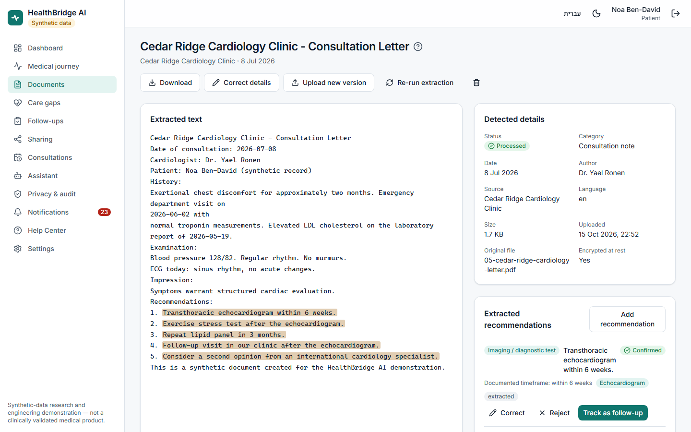 Recommendations linked to source passages |
| 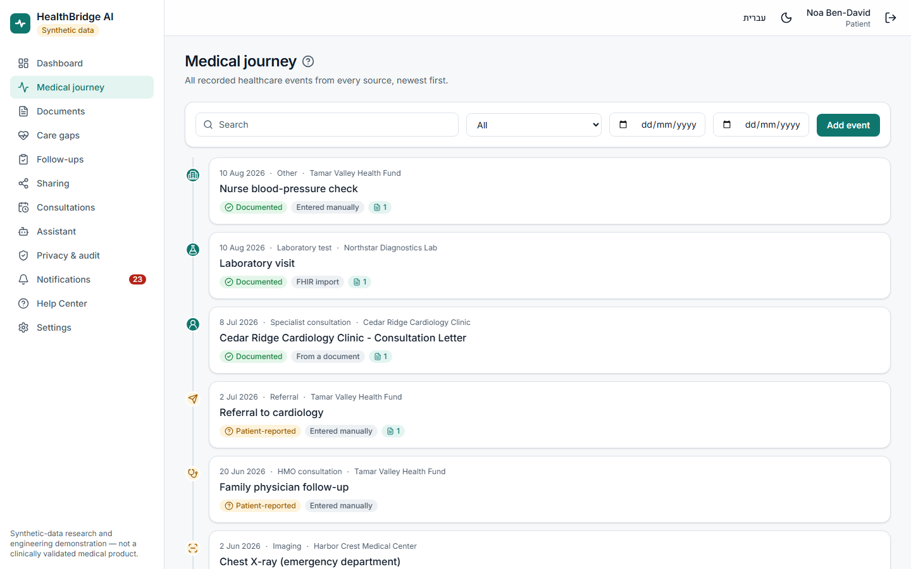 Medical journey | 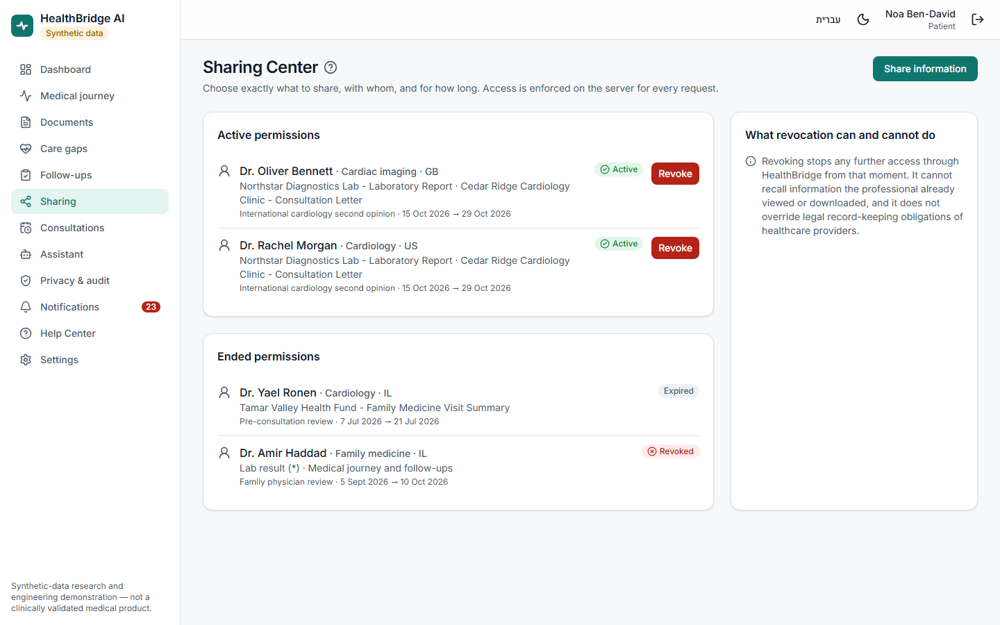 Sharing Center |
| 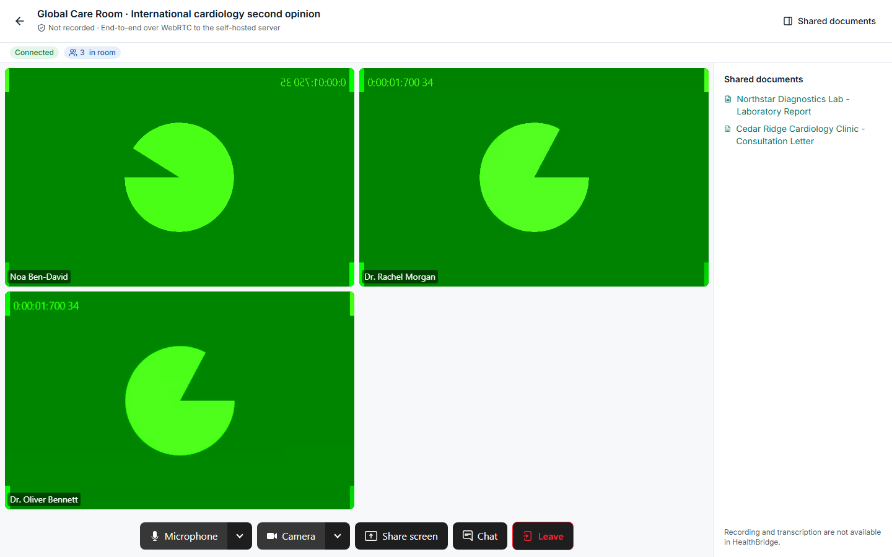 Global Care Room — 3 live participants (Chromium synthetic camera feeds) | 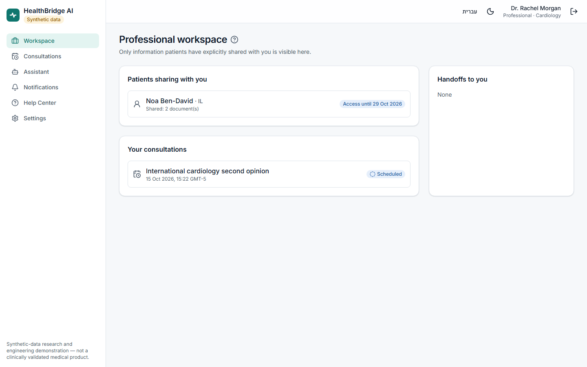 Professional workspace |
| 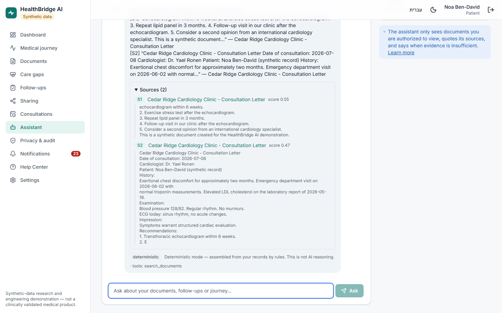 Assistant with cited sources | 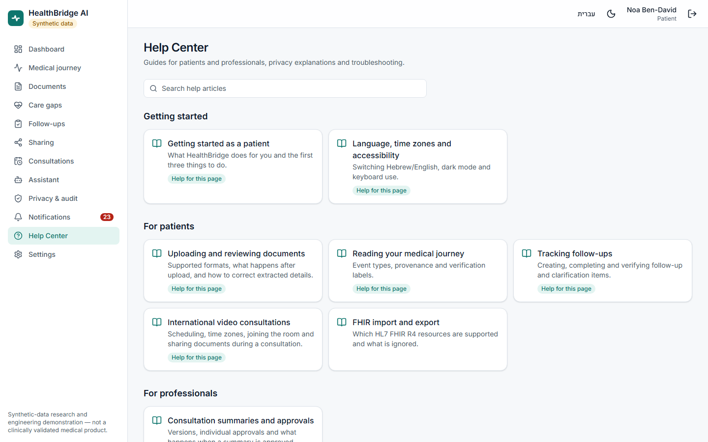 Help Center |
| 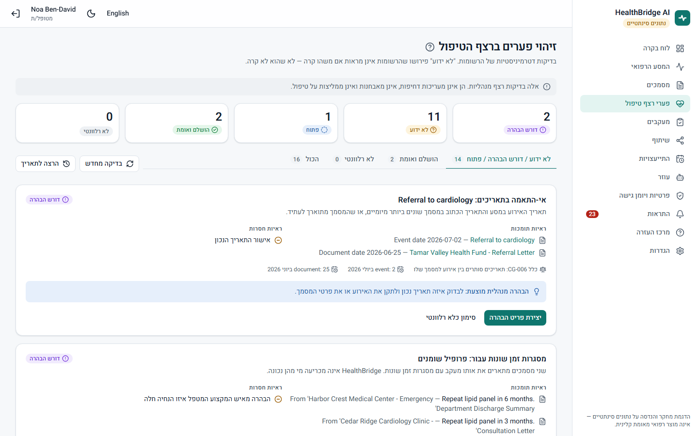 Hebrew / RTL | 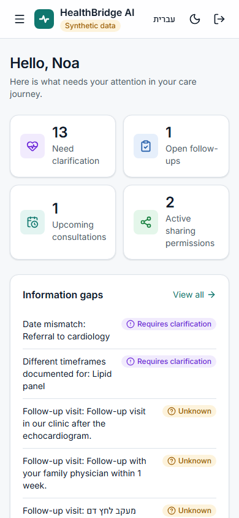 Mobile |

All screenshots are captured from the running application by `frontend/scripts/capture-screenshots.mjs`.

## Quick start

Requires Docker Desktop. No paid services.

```powershell
Copy-Item .env.example .env      # then replace every CHANGE_ME (see comments in the file)
docker compose up -d --build
```

Open **<http://localhost:8083>** → *Choose a demo scenario*. Stop with `docker compose down`; wipe with
`docker compose down -v`. Optional local LLM: `docker compose --profile ollama up -d`.
Details, LAN video and internet-deployment requirements: [docs/deployment.md](docs/deployment.md).

### Demo credentials (synthetic, demo mode only)

Password for all: `Demo-Passw0rd!`

| Email | Role |
|---|---|
| noa@patient.healthbridge.test | Patient (Israel) |
| dr.morgan@pro.healthbridge.test | Cardiologist (US) |
| dr.bennett@pro.healthbridge.test | Cardiac imaging (UK) |
| dr.ronen@pro.healthbridge.test | Cardiologist (IL) |
| admin@healthbridge.test | Administrator (no clinical access) |

More accounts and the 13-step walkthrough: [docs/demo-guide.md](docs/demo-guide.md).

## Demo scenario

A synthetic patient in Israel uploads a private cardiologist's letter. HealthBridge extracts five recommendations,
adds the visit to her journey, and reports that completion of the recommended echocardiogram **cannot be verified**.
She creates a clarification item, shares only the relevant documents with cardiologists in the US and UK, and holds a
three-way video consultation. Both physicians approve the summary individually; it is linked to her journey, the
"second opinion" referral becomes verified by evidence — and the echocardiogram stays *unknown* because no report exists.
Every access is in her audit history, and revoking a physician's access takes effect immediately.

## Test summary (executed 2026-10-16)

| Suite | Result |
|---|---|
| Backend unit + integration (PostgreSQL + pgvector) | **148 passed**, 0 failed |
| End-to-end (Playwright, Chromium) incl. full golden scenario and 3-participant real WebRTC video | **20 passed**, 0 failed |
| Accessibility (axe, 9 screens, WCAG A/AA rule tags) | 0 serious/critical violations |
| RAG retrieval evaluation (10 labeled queries) | hit@1 10/10, hit@3 10/10 (small synthetic corpus) |
| pip-audit / npm audit / gitleaks | 0 / 0 / 0 findings |
| Docker Scout — app images | 0 critical (backend 1 high, frontend 4 high in base OS) |

Evidence, method and defects found: [docs/testing.md](docs/testing.md).

## Security and privacy principles

Least privilege by default (professionals see nothing until a patient shares; admins never see clinical content) ·
authorization enforced server-side on every object · consent is specific, previewed, expiring and revocable ·
documents encrypted at rest · no content in logs · tamper-evident audit visible to the patient · no recording ·
no external services. Threat model and production gaps: [docs/security.md](docs/security.md).
Regulatory applicability (no compliance claimed): [docs/privacy-regulatory.md](docs/privacy-regulatory.md).

## AI limitations

The assistant does not diagnose, prescribe, assess urgency or change treatment. In the default deterministic mode its
answers are assembled by rules and labelled as such. The optional local LLM only rephrases cited excerpts and falls back
when output fails validation; small CPU models often do. Default embeddings are lexical, not semantic.
See [docs/ai-and-rag.md](docs/ai-and-rag.md) and [docs/known-limitations.md](docs/known-limitations.md).

## Synthetic-data disclaimer

Every patient, professional, organization and document is fictional. There are no integrations with real healthcare
institutions. Do not upload real medical information. Real clinical use would require clinical validation, regulatory
assessment, real identity and licence verification, and production security infrastructure.

## Technology

React 19 · TypeScript · Vite · Tailwind CSS 4 · TanStack Query · FastAPI · Pydantic · SQLAlchemy 2 · Alembic ·
PostgreSQL 16 + pgvector · LiveKit (self-hosted) · Ollama (optional) · Docker Compose · Playwright · axe-core.

## Documentation

[Architecture & API](docs/architecture.md) · [Care gap rules](docs/care-gap-rules.md) · [AI agent & RAG](docs/ai-and-rag.md) ·
[FHIR](docs/fhir.md) · [Security & threat model](docs/security.md) · [Privacy & regulatory](docs/privacy-regulatory.md) ·
[Testing & evidence](docs/testing.md) · [Deployment](docs/deployment.md) · [Demo guide](docs/demo-guide.md) ·
[Known limitations](docs/known-limitations.md) · [References](docs/research-references.md)
