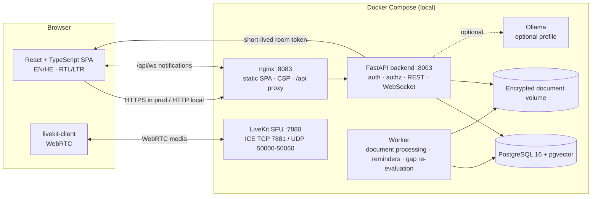
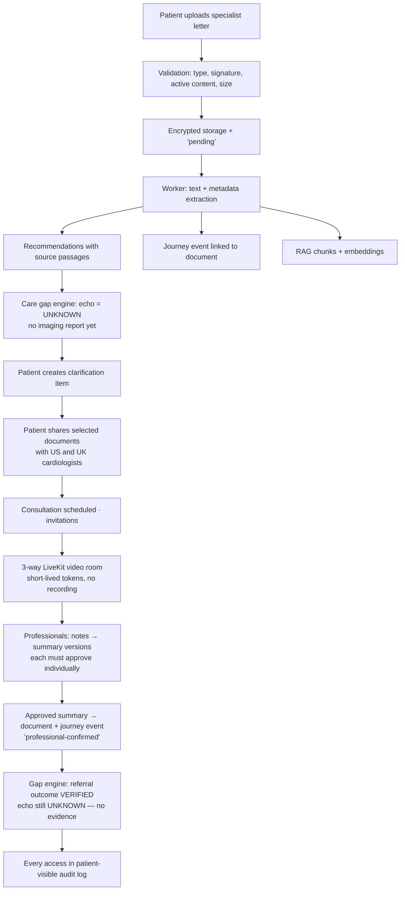
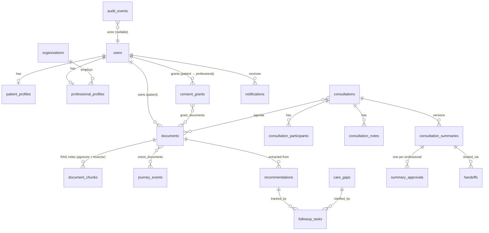

# Architecture

HealthBridge AI is one application with three product pillars that share a single identity,
authorization, data and audit model:

| Pillar | What it covers | Main code |
|---|---|---|
| A — Patient Intelligence | documents, extraction, journey, care gaps, follow-ups, assistant | `services/extraction.py`, `services/documents.py`, `services/care_gaps.py`, `services/agent.py` |
| B — Global Care Collaboration | consultations, LiveKit rooms, notes, summaries, handoffs | `api/consultations.py`, `services/meetings.py`, `pages/MeetingRoom.tsx` |
| C — Trust, Privacy & Governance | consent grants, server-side authorization, audit chain, observability | `authz.py`, `api/sharing.py`, `audit.py`, `observability.py` |

## Components

* **No message broker.** The worker claims pending documents with `SELECT … FOR UPDATE SKIP LOCKED`.
* **No external services.** No paid APIs, no cloud, no email/SMS. Ollama is optional and off by default.
* **Backend port 8003** is only reachable inside the Docker network; the browser talks to nginx on
  `127.0.0.1:8083`, which proxies `/api` and `/api/ws`.

## Request lifecycle and security layers

1. nginx adds CSP, `X-Frame-Options`, `Permissions-Policy` etc. and a request ID.
2. `RequestContextMiddleware` binds the request ID, client IP and timing; logs are structured JSON with redaction.
3. `get_current_user` validates the opaque session cookie (hash stored server-side) and, for unsafe methods, the CSRF header.
4. Role check (`require_patient`, `require_clinical`, `require_admin`).
5. **`AccessPolicy`** (`authz.py`) decides object-level access — the single source of truth:
   patients see only their own records; professionals see only what an *active* consent grant covers;
   admins have no clinical access; invisible objects return **404** (BOLA/IDOR resistant); denials are audited.
6. Every sensitive action appends to the HMAC-chained audit log.

## Patient journey (golden scenario)

## Data model (main tables)

Key design choices:

* UUID primary keys for every API-exposed object (no enumerable IDs).
* Recommendations keep `passage`, `char_start`, `char_end` so every extracted item links to its source text.
* `due_date` is set **only** when explicitly written in a document or entered by a user; relative timeframes stay as text.
* Care gaps are upserted by a deterministic fingerprint; human review status (`not_applicable`, `requires_clarification`) is stored separately from the computed status and survives re-evaluation.
* Document versions share a `lineage_id`; only `is_latest` versions feed care gaps and RAG.
* `document_chunks.tsv` is a generated `tsvector` column (GIN index); `embedding` is `vector(384)` (HNSW, cosine).
* Schema is managed by Alembic (`backend/alembic/versions/0001_initial_schema.py`).

## API overview

All endpoints are under `/api`. Interactive OpenAPI docs: `http://localhost:8083/api/docs` (disabled when `HB_ENVIRONMENT=production`).

| Area | Endpoints |
|---|---|
| Auth | `POST /auth/login`, `/auth/logout`, `/auth/register` (demo only), `GET/PATCH /auth/me`, `POST /auth/change-password` |
| Documents | `GET/POST /patients/{pid}/documents`, `GET/PATCH/DELETE /documents/{id}`, `GET /documents/{id}/download`, `POST /documents/{id}/versions`, `/reprocess`, `GET /patients/{pid}/fhir/export`, `GET /organizations` |
| Journey | `GET/POST /patients/{pid}/journey`, `GET/PATCH /journey/{id}` |
| Recommendations | `GET/POST /patients/{pid}/recommendations`, `PATCH /recommendations/{id}`, `POST /recommendations/{id}/track` |
| Care gaps | `GET /patients/{pid}/care-gaps`, `POST …/evaluate`, `GET …/replay?as_of=`, `POST /care-gaps/{id}/review`, `GET /care-gaps/rules` |
| Follow-ups | `GET/POST /patients/{pid}/tasks`, `PATCH /tasks/{id}`, `POST /tasks/{id}/complete|verify|reopen|dismiss`, `GET /tasks/{id}/history` |
| Sharing | `GET /professionals`, `POST /patients/{pid}/grants/preview`, `GET/POST /patients/{pid}/grants`, `POST /grants/{id}/revoke`, `GET /patients/{pid}/access-log`, `GET /shared-with-me` |
| Consultations | `GET/POST /consultations`, `GET/PATCH /consultations/{id}`, `POST …/respond|cancel|documents|share|join|presence|notes|complete` |
| Summaries & handoffs | `GET/POST /consultations/{id}/summaries`, `POST …/summaries/draft`, `POST /summaries/{id}/observations|approve|request-changes|acknowledge|handoffs`, `GET /handoffs`, `POST /handoffs/{id}/decide|acknowledge` |
| Assistant | `GET /assistant/status`, `POST /assistant/query`, `POST /assistant/actions/{id}/confirm|cancel` |
| Notifications | `GET /notifications`, `POST /notifications/{id}/read`, `/read-all`, `GET/PUT /notifications/preferences`, `WS /ws` |
| Admin | `GET/POST /admin/users`, `PATCH /admin/users/{id}`, `GET /admin/security-events`, `/admin/audit/verify`, `/admin/system`, `GET/PUT /admin/config`, `POST /admin/demo/reset` |
| System | `GET /health`, `/ready`, `/meta`, `/demo/scenarios` (demo mode only) |

## Frontend

React 19 + TypeScript + Vite + Tailwind CSS 4, TanStack Query for server state, React Router 7,
`@livekit/components-react` for the room. A small in-house accessible component set
(`components/ui.tsx`) uses native `<dialog>`, labelled fields, text+icon status badges and logical CSS
properties so the same layout works in RTL. Clinical panels (documents, journey, care gaps) are shared
between the patient's own pages and the professional's consented view. The LiveKit bundle is lazy-loaded
only for the meeting room.
